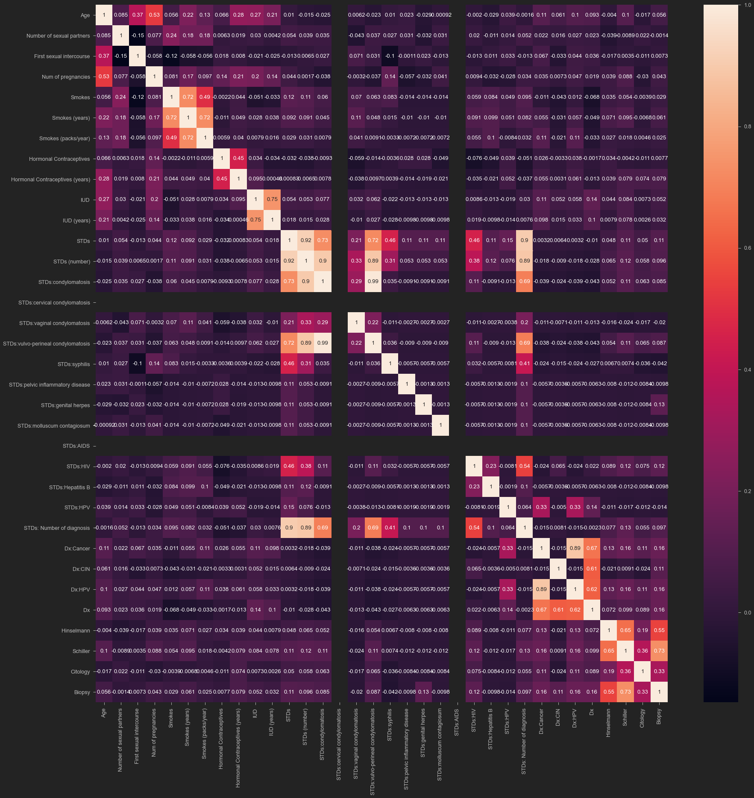
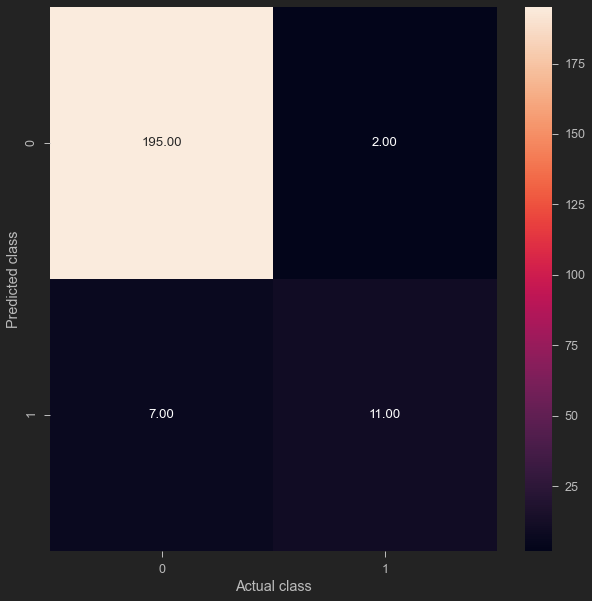

# Can a patient's history flag who needs a biopsy?

An XGBoost classifier that predicts the biopsy result in a public cervical
cancer screening dataset, with an honest look at what the test accuracy does
and does not mean.

## Project background

Cervical cancer screening combines a patient's history with a sequence of
tests: colposcopy (Hinselmann), Schiller's iodine test, cytology and finally
biopsy, which is the main way doctors confirm most cancers. Biopsies are the
costly and invasive end of that sequence, so a model that ranks patients by
likelihood of a positive result could help a clinic decide who to prioritise.

This project trains a gradient-boosted tree model on the UCI Machine Learning
Repository dataset and covers three areas:

- **Data preparation:** missing values, columns too sparse to keep, scaling
- **Model performance:** accuracy, precision and recall on a held-out test set
- **Safe use:** where the result is trustworthy and where it is not

Links to the technical work:

- Modelling notebook: [notebooks/01-xgboost-risk-model.ipynb](notebooks/01-xgboost-risk-model.ipynb)
- Data source note: [data/README.md](data/README.md)
- Method and results detail: [docs/METHODOLOGY.md](docs/METHODOLOGY.md)

## Data structure and initial checks

The dataset has **858 rows, one per patient, and 36 columns** covering
demographics, sexual and reproductive history, smoking, contraceptive use,
sexually transmitted infection (STD) history, earlier diagnoses and four test
results (Hinselmann, Schiller, Citology, Biopsy). Missing values are recorded
as `?`. Two columns, the time since first and last STD diagnosis, have **71
non-null values out of 858** and were dropped, leaving 34 columns. Remaining
gaps were filled with the column mean.

The target is `Biopsy`. Positive cases are rare: the test split holds **202
negative and 13 positive patients**, so a model that always answers "negative"
would look accurate while finding no one.

*Pairwise correlations. Biopsy correlates most with the Schiller (0.73) and
Hinselmann (0.55) test results, not with lifestyle history.*

## Executive summary

The model scored **95.8% accuracy on the 215-patient test set** (training
accuracy 99.8%) and found **11 of the 13 patients with a positive biopsy**, an
85% recall. It paid for that with 7 false alarms, so only 61% of the patients
it flagged were positive. The strongest signals in the data are other screening
test results, which means the model is closer to a test-result combiner than a
risk predictor built from patient history alone.

*Rows are predicted class, columns are actual class. 195 true negatives, 2
missed positives, 7 false positives, 11 true positives.*

## Results

### Model performance

- **Accuracy 95.8% on test, 99.8% on training.** The gap suggests the model
  fits the training data more closely than it generalises.
- **Recall for positives is 85%.** 11 of 13 positive patients were found; 2
  were missed.
- **Precision for positives is 61%.** Of 18 patients flagged, 11 were positive
  and 7 were not.
- **Negatives are handled well:** precision 0.99 and recall 0.97 across 202
  negative patients.

### What drives the result

- **Other test results dominate.** The input set has 33 columns, which
  includes the Hinselmann, Schiller and Citology results alongside history.
  The correlation heatmap shows these relate to Biopsy far more strongly than
  any history variable (0.55, 0.73 and 0.33, against 0.13 or below for
  history columns such as genital herpes).
- **Several STD columns move together.** Pairs such as condylomatosis and
  vulvo-perineal condylomatosis correlate at 0.99, so individual coefficients
  are not interpretable.

## Recommendations

For a screening clinic or a data team evaluating this approach:

- Recall is high at 85% but based on 13 positive patients. **Use the model to
  rank patients for follow-up, never to rule anyone out.**
- Most of the signal comes from earlier test results. **Do not describe it as
  a prediction from patient history; build a history-only version to test that
  claim.**
- 7 false alarms came with 11 true positives. **Treat a flagged result as a
  prompt for clinical review, and agree the acceptable false-alarm rate with
  clinicians first.**
- The model has not been checked on another population. **Validate on data
  from the clinic's own patients before any operational use.**

## Assumptions and caveats

- **Small dataset:** 858 patients and 13 positives in the test split. One
  patient more or fewer moves recall by several percentage points.
- **Class imbalance:** accuracy alone is misleading. Report recall and
  precision for the positive class.
- **Single split, no cross-validation:** the figures come from one run and
  vary with the split.
- **Mean imputation** assumes missing values are uninformative, which may not
  hold when patients decline to answer.
- **Screening, not diagnosis.** A positive prediction is not a diagnosis and a
  negative one is not an all-clear.
- The notebook as committed contains outputs and comments but several code
  cells are empty, so it cannot be re-run end to end. See
  [docs/SETUP.md](docs/SETUP.md).

## Technical detail

- How to run it: [docs/SETUP.md](docs/SETUP.md)
- Method, earlier run and full metrics: [docs/METHODOLOGY.md](docs/METHODOLOGY.md)

## Data and licensing

The data comes from the UCI Machine Learning Repository and is anonymised. It
is not redistributed beyond the CSV already in this repository; see
[data/README.md](data/README.md). Code is MIT licensed.
